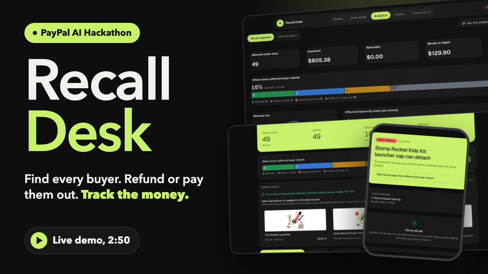
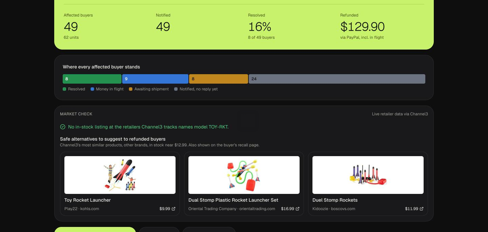
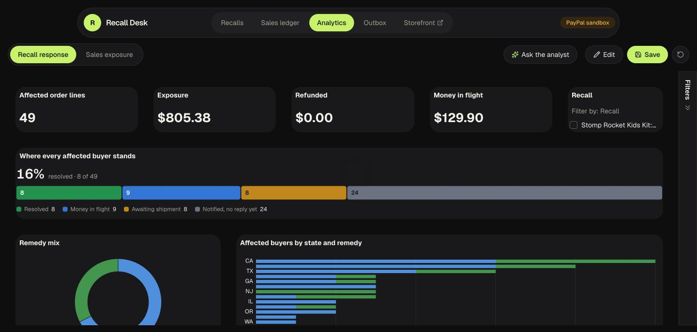
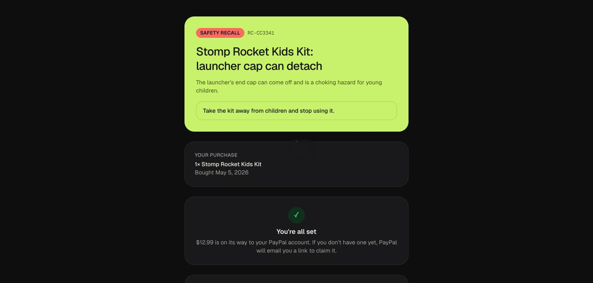
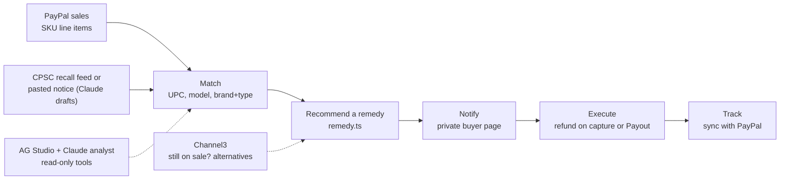

# Recall Desk

**When a product is recalled, small sellers rarely know who bought it. PayPal does. Recall Desk finds every buyer in your PayPal sales, recommends and pays the right remedy, and tracks the money until PayPal confirms it.**

[](https://youtu.be/Kse_1R138iQ)

| | |
| --- | --- |
| **Live demo** | https://recall-desk-zi89.onrender.com (PayPal sandbox, no login; the free instance sleeps when idle, so the first load can take about a minute) |
| **Demo video** | https://youtu.be/Kse_1R138iQ (a real run on the live site; the narration, music and sound effects are AI generated, and Claude Code drove the recording) |
| **Built for** | PayPal AI Hackathon. Sponsor tools: AG Grid (AG Studio), Channel3, Render |
| **License** | MIT |

[](https://render.com/deploy?repo=https://github.com/shiwani42/recall-desk)

<table>
  <tr>
    <td width="33%"><a href="docs/images/recall-page.png"></a><br><sub>A recall: where every buyer stands, plus the Channel3 market check</sub></td>
    <td width="33%"><a href="docs/images/analytics.png"></a><br><sub>Analytics on AG Studio, with a Claude recall analyst</sub></td>
    <td width="33%"><a href="docs/images/buyer-page.png"></a><br><sub>What the buyer sees after their refund</sub></td>
  </tr>
</table>

## What a judge should know in one minute

- **The problem.** A recall only works if the seller can reach the people who bought the product. For a small seller, that data is scattered. Every PayPal payment, though, already carries SKU-level line items, the buyer's contact details and a shipping address, and PayPal can send the money back.
- **What it does.** Given a recall, Recall Desk finds the affected buyers, recommends a remedy for each one and shows why, sends them a private page to choose, pays refunds through PayPal, and tracks every case until PayPal confirms the money moved.
- **Where AI is used, and where it is not.** Claude drafts a recall from a pasted notice and powers an analyst on the analytics page. The analyst reuses the app's real matching, remedy and refund-route code to answer "what would this recall cost?", then builds the dashboard for it. None of its tools can send a refund or an email. Money only moves when the seller applies a refund or a buyer picks a remedy.
- **What is real.** The PayPal calls are real sandbox transactions: partial refunds on captures and Payouts, with PayPal's own IDs. The recall feed is the real US CPSC API, and the market data is live Channel3 data. What is test data is listed under [Real versus test data](#real-versus-test-data).

## Try it in two minutes (no credentials)

Open https://recall-desk-zi89.onrender.com.

1. **Home.** The lime card is the **recall watch**: a real CPSC recall of a DREO heater matched to a product in the sales ledger.
2. **Open the Stomp Rocket recall** under "Your recalls". You get every affected buyer, the recommended fix and why, the refund route per buyer, and the **Market check** (live Channel3 data).
3. **The buyer's side.** Open **Outbox**, expand a notice and click its link. That's the private page a buyer sees.
4. **Analytics.** Click **Ask the analyst** and try: *"What would it cost to recall every HTR-200 sold in the last 6 months? Split it by how the money would move, and add widgets for it on a new page."* Watch it call its tools and hand the widgets to Studio's agents.
5. **Start a recall yourself.** **New recall**, then Recall watch, then *Use this notice* (DREO), then create and notify. A buyer who chooses a refund on their page triggers a real sandbox refund.

> **Sandbox money moves for real.** *Apply recommended refunds*, *Refund*, a buyer's *Confirm my choice* and *Sync with PayPal* all call PayPal's sandbox. A captured sale can be refunded once; a second try returns `CAPTURE_FULLY_REFUNDED`. The free instance reseeds fresh sandbox sales whenever it boots, so a cold start gives you a clean slate. Notices are logged to the Outbox (the demo has no SMTP configured), so no email is sent.

The storefront (`/store`) takes sandbox payments from a PayPal sandbox **personal** account of your own (developer.paypal.com, Testing Tools, Sandbox Accounts). The sale lands in the ledger. You don't need it to evaluate the rest.

## How PayPal is used

PayPal is the system of record, not decoration. Every recall decision is made from PayPal data and every payout goes back through PayPal.

| PayPal capability | What Recall Desk does with it | Where |
| --- | --- | --- |
| JS SDK v6 and Orders | Storefront checkout. Each captured order becomes a SKU-level sale, keyed on its capture ID so importing it twice is safe | `app/store`, `lib/paypal/orders.ts`, `lib/sales.ts` |
| Payments (refunds) | Partial refund of only the recalled line on the original capture (within 180 days) | `lib/paypal/payments.ts`, `lib/recalls/execute.ts` |
| Payouts | The second route, for sales past PayPal's 180 day refund window or with no capture on file. A payout to someone without a PayPal account stays `UNCLAIMED`, so the case stays "money in flight" | `lib/paypal/payments.ts`, `lib/recalls/sync.ts` |
| Transaction Search | **Import from PayPal** pulls up to 3 years of past sales, including ones made outside this storefront | `lib/importer.ts` |
| Webhooks | Verified endpoint plus a manual **Sync with PayPal**, so refunds and payouts settle without guessing | `app/api/paypal/webhook/route.ts`, `lib/recalls/sync.ts` |

Amounts never come from the browser: prices are read from the `products` table, and money is integer cents (`lib/money.ts`).

## How AI is used

Claude Haiku 5.5 (Anthropic API) does two jobs.

1. **Draft a recall from a pasted manufacturer notice.** Structured output, matched against the seller's catalog with the evidence for each SKU. The seller reviews it before anything is created (`lib/ai.ts`).
2. **Power the recall analyst in AG Studio.** AG Studio's agent framework ships no model adapters, so `components/analytics/claude-adapter.ts` translates Studio's conversation items and AG-UI events to and from the Anthropic Messages API (unit-tested). It runs in the browser and calls `/api/ai/claude`, a same-origin, rate-limited proxy that holds the key and pins the model.

The analyst's own tools (`components/analytics/ai.ts`):

| Tool | What it does | Writes anything? |
| --- | --- | --- |
| `recall_exposure` | "What would recalling X cost?" using the real matching, remedy and refund-route logic over the ledger | No |
| `refresh_paypal_status` | Re-reads PayPal for refunds and payouts still in flight | Updates statuses only |
| `market_check` | Channel3 retailer data for a SKU | No |
| `create_page` | Adds and names a dashboard page, because Studio's agents can't create pages | Dashboard only |

Studio's own agents (lead, data, page, planning, widget) then build the widgets. **No tool can send a refund or an email.** That is deliberate: the AI investigates and prepares, people decide.

## What is different here

- **Matching that avoids false alarms.** UPC first, then model number, then brand plus product type. Product type alone never counts, so a recall of "space heaters" does not flag every heater. Only the affected line item is matched, not the whole cart (`lib/recalls/matcher.ts`, tests in `tests/matcher.test.ts`).
- **A remedy engine you can read.** Pure code with unit tests (`lib/recalls/remedy.ts`): if only one remedy is offered, that one; high severity means refund (fastest unit removal); a unit under $20 means refund (cheaper than shipping a fix); replace when stock exists, allocated to the oldest sales first; otherwise repair, then refund. The recommendation is a default, and buyers can choose any remedy the recall offers.
- **Honest money states.** A case moves `identified`, `notified`, then `remedy_selected` or `processing` (PayPal money in flight), then `resolved` or `failed`. "Sent" and "resolved" are separate on purpose, because unclaimed payouts are not done.
- **Agents that use the app's real logic**, not a copy of it, so the analyst's numbers are the numbers the app would pay.
- **Channel3 in both directions.** Is the recalled model still on sale elsewhere (and where to report it)? And what in-stock alternative from another brand can we show the buyer next to their refund? Alternatives come from Channel3's `/v1/similar`, seeded with the recalled product's own listing or the closest in-stock match, with search as the fallback (`lib/channel3.ts`).

## Architecture



One Next.js 16 app (App Router, Server Actions, `cacheComponents`), SQLite through Drizzle (migrations apply on startup), `zod` validation on every Server Action. Business logic lives in `lib/` and is tested against an in-memory database; Server Actions in `app/*actions.ts` stay thin.

```
lib/recalls/      matcher, remedy, service, execute, sync, notify, watch, exposure
lib/paypal/       client, orders, payments (refund + payout)
lib/channel3.ts   market check          lib/cpsc.ts   CPSC client
components/analytics/   AG Studio: data, report, theme, widget, Claude adapter, agent team
scripts/seed.ts   real sandbox sales + imported history + a past recall
```

## Sponsor tools

| Sponsor | What we built with it | Where |
| --- | --- | --- |
| **AG Grid (AG Studio)** | Two dashboards over the ledger joined by Studio's data engine; a custom *Recall progress* widget with AI metadata so agents can place it; a theme driven by our CSS tokens (light and dark); a stacked phone layout via Studio's responsive breakpoints; the Studio Agent Framework running on Claude through our own adapter | `components/analytics/*` |
| **Channel3** | Market check on the recall page, the buyer's page and the analyst's `market_check` tool, using `/v1/search` and `/v1/similar` | `lib/channel3.ts`, `components/MarketCheck.tsx`, `app/api/analytics/market` |
| **Render** | Hosted from a `render.yaml` blueprint as a free web service with a health check; on boot it seeds fresh PayPal sandbox sales. `GET /api/health` reports the live database and what the seed did | `render.yaml`, `scripts/seed.ts`, `app/api/health` |

## Real versus test data

- **Real, within the PayPal sandbox:** the 10 seeded sales are card payments captured through PayPal's sandbox, and the seeded past recall sends real sandbox Payouts. Refund and payout IDs are PayPal's.
- **Test data:** 4 older sales and 280 orders of imported history (from the last 14 months) are synthetic and deterministic, with fictional `@example.com` buyers and no PayPal capture, so refunds on them go out as Payouts. Those buyers have no PayPal accounts, so their payouts stay `UNCLAIMED` (money in flight). That is the correct behavior, not a bug.
- **Real external data:** the US CPSC recall feed, and Channel3's retailer data.

## Quality evidence

```bash
npm ci
npm test                 # 89 unit and database tests, no network, no keys
npm run lint
npm run typecheck        # runs `next typegen` first
npm run build            # production build
```

The tests cover the remedy engine, the matcher, refund execution and PayPal status sync, the CPSC importer, the Claude adapter for Studio, the Channel3 seeding and fallback, the phone layout, and the Outbox link rendering. The recall-matching tests (`tests/matcher.test.ts`) guard against the "product type alone" false positive.

## Run it yourself

You need a free PayPal sandbox app ([developer.paypal.com](https://developer.paypal.com), Apps and Credentials). Enable **Expanded checkout, then Advanced Credit and Debit Card Payments** in the app's Features, because the seed pays with test cards. Tests, lint, typecheck and build need no keys.

```bash
cp .env.example .env.local   # add the sandbox Client ID and Secret
npm run paypal:check         # verify credentials
npm run db:seed -- --reset   # real sandbox sales, imported history and a past recall
npm run dev                  # http://localhost:3000
```

| Variable | Needed for |
| --- | --- |
| `NEXT_PUBLIC_PAYPAL_ENVIRONMENT`, `NEXT_PUBLIC_PAYPAL_CLIENT_ID`, `PAYPAL_CLIENT_SECRET` | PayPal (required). The secret is server-only |
| `ANTHROPIC_API_KEY` | Recall drafting and the analytics agents (the dashboard works without it; the chat hides) |
| `AG_STUDIO` | AG Studio licence key (without it Studio shows a trial watermark) |
| `CHANNEL3_API_KEY` | Market check |
| `SMTP_URL`, `EMAIL_FROM`, `EMAIL_REDIRECT_TO` | Real email delivery, with a demo-safe redirect (otherwise notices are only logged to the Outbox) |
| `PAYPAL_WEBHOOK_ID`, `APP_URL` | Webhook verification, and the public base URL for links in emails |

Every sandbox refund is real within the sandbox, so run `npm run db:seed -- --reset` for fresh captures. If refunds or payouts fail with `INSUFFICIENT_FUNDS`, top up the sandbox balance with `npx tsx --env-file-if-exists=.env.local scripts/fund-sandbox.ts 8 500`. After a seed, `GET /api/health` shows how many sales exist and what the seed managed (captures made, any PayPal error, payouts sent).

## Pages

| Page | What it is for |
| --- | --- |
| `/` | Seller console: recall watch, recalls, progress, ledger stats |
| `/recalls/new` | Start a recall from the recall watch, a CPSC search, a pasted notice (AI), or from scratch |
| `/recalls/[id]` | Affected buyers, recommended fix and why, notify, refund, mark shipped, Market check |
| `/r/[token]` | The buyer's private page: choose refund, replacement or repair |
| `/analytics` | AG Studio dashboards and the Claude recall analyst |
| `/sales` | The SKU-level sales ledger. **Import from PayPal** pulls past sales |
| `/outbox` | Every email sent to buyers, with delivery status and retry |
| `/store` | Demo storefront: pay with a sandbox account and the sale lands in the ledger |

## What is not built

Stated plainly, so you can weigh it:

- **Seller sign-in.** The console's actions are unauthenticated. That is fine for a demo and not for real use.
- **Webhook registration on the hosted demo.** The endpoint exists and verifies signatures, but it isn't registered there, so the demo uses **Sync with PayPal**.
- **Persistent storage.** SQLite on the free instance's ephemeral disk, reseeded on boot. A hosted database would let the recall watch, status sync and notice fan-out run as background jobs.
- **Email on the hosted demo.** The code sends through any SMTP provider; the demo has none configured.
- **Coverage.** The recall feed is US CPSC only (other regions would plug into `lib/cpsc.ts`'s `Notice` shape), and tracking numbers for replacements are not pushed back to PayPal.
- **Domain validation.** The remedy rules are our own reasonable defaults. We are not product-safety experts, and would validate them with sellers and recall practitioners before real use.

## Where each judging criterion is answered

| Criterion | Look at |
| --- | --- |
| Technological implementation | [How PayPal is used](#how-paypal-is-used), [How AI is used](#how-ai-is-used), [Quality evidence](#quality-evidence) |
| Design | The screenshots above, light and dark mode, the phone layout, the buyer's page |
| Potential impact | The first section and [What is different here](#what-is-different-here) |
| Innovation | [What is different here](#what-is-different-here), especially the analyst built on the app's real logic |
| Presentation | The [demo video](https://youtu.be/Kse_1R138iQ) and [Try it in two minutes](#try-it-in-two-minutes-no-credentials) |

More notes for people extending the project are in [`HANDOFF.md`](HANDOFF.md). The Devpost copy is in [`docs/devpost.md`](docs/devpost.md).

## License

[MIT](LICENSE)
